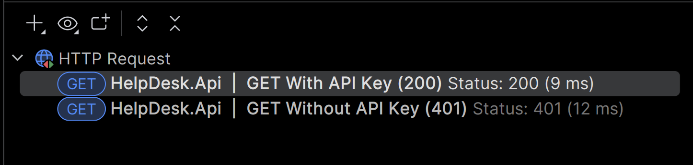
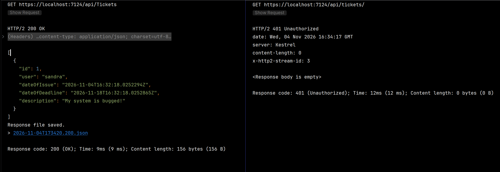

# Help Desk API

Week 45 notes

---

## Overview
- [Week 44 (separate document)](Week44_Introduction.md)
- [Week 45](#week-45)
  - [Explain the Request Pipeline](#explain-request-pipeline-and-middleware-order)
  - [Short-circuiting and the next delegate](#short-circuiting-and-correct-use-of-the-next-delegate)
  - [Custom Middleware Class](#custom-middleware-class)
  - [Distinguish Between Middleware and Filters](#distinguish-between-middleware-and-filters)
  - [Register Services in the DI Container With the Right Lifetime](#register-services-in-di-container-with-right-lifetime)
  - [Use Constructor Injection](#constructor-injection-and-why-service-locator-is-anti-pattern)
  - [Set up the Options Pattern with Validation](#set-up-options-pattern-with-validation)
  - [Explain Why Secrets Don't Belong in appsettings.json](#why-secrets-dont-belong-in-appsettingsjson)
  - [Describe Responsibility, Dependency Diagram](#responsibility-of-each-layer--dependency-diagram)
  - [Compare Technical Layering and Feature-Based Structure](#compare-technical-layering-and-feature-based-structure)
- [Sources](#sources)

---

## Week 45

Learning goals for week 45:

Goals for this project:
- [x] 1 I can explain the request pipeline and what the order of middleware means
- [x] 2 I can explain short-circuiting and the correct use of the next delegate
- [x] 3 I can write a custom middleware class
- [x] 4 I can distinguish between middleware and filters and explain their use cases
- [ ] 5 I can register services in the DI container with the right lifetime
- [ ] 6 I can use constructor injection and explain why Service Locator is an anti-pattern
- [ ] 7 I can set up the Options pattern with validation and use IOptions in a controller
- [ ] 8 I can explain why secrets don't belong in appsettings.json
- [ ] 9 I can describe the responsibility of each layer and draw a dependency diagram
- [ ] 10 I can compare technical layering and feature-based structure

---

### Explain Request Pipeline and Middleware Order

The request passes through the middleware in the order they are registered in `Program.cs`.  
Then the response travels back in the reverse order. 

The exception handler should always be registered first of all middleware.  

```csharp
app.UseExceptionHandler("/error");
```

When it is first, it wraps everything that comes after it and can catch any exceptions from them.  
It can't catch exceptions from middleware that is registered before it.

For three middleware A, B, C and an endpoint, the order is:
```terminaloutput
A in, B in, C in, endpoint, C out, B out, A out.
```
Authentication goes before authorization, because authorization needs the
identity that authentication produces.


[Handle errors in ASP.NET Core (Microsoft)](https://learn.microsoft.com/en-us/aspnet/core/fundamentals/error-handling?view=aspnetcore-10.0)

[🏠 To top](#overview)

---

### Short Circuiting And Correct Use of the Next Delegate

Tested in `Program.cs`: 

```csharp
app.Use(async (context, next) =>
{
    Console.WriteLine($"A in {context.Request.Path}");
    
    await next.Invoke(context);
    
    Console.WriteLine("A out");
});
app.Use(async (context, next) =>
{
    Console.WriteLine($"B in {context.Request.Path}");

    await next.Invoke(context);

    Console.WriteLine("B out");
});
```

Output:

```text
A in /api/tickets
B in /api/tickets
B out
A out
A in /favicon.ico
B in /favicon.ico
B out
A out
```

- When A reaches `await next(...)`, it pauses and waits.  
- B runs inside that wait. Then B pauses when it reaches `await next(...)`, while the controller runs.  
- When the controller finishes, the code resumes in reverse:  
- B continues after its `next` (B out), and only then can A continue (A out).

**Full middleware and short-circuit testing code with comments:**  

```csharp
app.Use(async (context, next) =>
{
    Console.WriteLine($"A in {context.Request.Path}"); // "A in" runs fine, and moves to await next.
    await next.Invoke(context); // Calls "B in"
    
    Console.WriteLine("A out"); // From "B out", control goes back to "A", prints "A out".
});
app.Use(async (context, next) =>
{
    Console.WriteLine($"B in {context.Request.Path}"); // "B in" runs, and moves to await next.

    await next.Invoke(context); // Calls "C in"

    Console.WriteLine("B out"); // after "return" in "C", control comes back to B, prints "B out" - moves to A.
});
app.Use(async (context, next) =>
{
    Console.WriteLine("C in"); // "C in" runs, then it requests a context Header "X-Api-key", which does not exist:
    if (!context.Request.Headers.ContainsKey("X-Api-Key")) // this will never make it to "next", short-circuiting the chain
    {
        context.Response.StatusCode = 401;
        return; // From here "C" is done, and control goes back to "B".
    }
    await next.Invoke(context); // this never fires when the header is missing
    Console.WriteLine("C out"); // "C out" never runs if header is missing. Neither does the following middleware
});
```

When the API key is missing, C returns without calling `next`:

```terminaloutput
A in /api/tickets
B in /api/tickets
C in
B out
A out
```

There is no "C out", and the controller never runs.

Not calling `next` is correct when the middleware answers the request itself,
for example a failed key check. It is a bug in middleware that should pass the
request on, because then the endpoint never runs.

[Routing in ASP.NET Core (Microsoft)](https://learn.microsoft.com/en-us/aspnet/core/fundamentals/routing?view=aspnetcore-10.0)  
[ASP.NET Core Middleware](https://learn.microsoft.com/en-us/aspnet/core/fundamentals/middleware/?view=aspnetcore-10.0)  

[🏠 To top](#overview)

---

### Custom Middleware Class

For this, I wrote the custom middleware `ApiKeyMiddleware`.  
It needs a public constructor that takes a `RequestDelegate` parameter, and a public 
`Invoke` or `InvokeAsync` method that returns `Task` with `HttpContext` parameter.

It is important that you don't have typos in the `Invoke` method, because the framework will look 
for the method at runtime, and will throw an exception at you.

```csharp
namespace HelpDesk.Api.Middleware;

internal class ApiKeyMiddleware
{
    private readonly RequestDelegate _next;
    
    public ApiKeyMiddleware(RequestDelegate next)
    {
        _next = next;
    }

    public async Task InvokeAsync(HttpContext httpContext)
    {
        if (!httpContext.Request.Headers.ContainsKey("X-API-Key"))
        {
            httpContext.Response.StatusCode = 401;
            return;
        }
        await _next.Invoke(httpContext);
    }
}
```

I then registered it in `Program.cs` with the rest of the middleware (but after Exception Handler), 
like this: 

```csharp
app.UseMiddleware<ApiKeyMiddleware>();
```

**Http requests**  

```http request
@host = https://localhost:7124

### GET Without API Key (401)
GET {{host}}/api/tickets/
Accept: application/json

### GET With API Key (200)
GET {{host}}/api/Tickets
Accept: application/json
X-Api-Key: anything

```

**Results With and Without API Key**  

  



This works because the check in the middleware (`ContainsKey` and `Response.StatusCode`)
only stops the request when the header is missing. When an API key is supplied, the
request continues down the pipeline to the controller.

I also wrote `RequestTimingMiddleware` and an extension for it: `RequestTimingMiddlewareExtension`.

```csharp
using System.Diagnostics;

namespace HelpDesk.Api.Middleware;

internal class RequestTimingMiddleware
{
    private readonly RequestDelegate _next;

    public RequestTimingMiddleware(RequestDelegate next)
    {
        _next = next;
    }

    public async Task InvokeAsync(HttpContext context)
    {
        var stopwatch = Stopwatch.StartNew();

        await _next(context);

        var statusCode = context.Response.StatusCode;

        Console.WriteLine(
            $"{context.Request.Method} {context.Request.Path} {statusCode} {stopwatch.ElapsedMilliseconds} ms");
    }
}
```

Extension:  

```csharp
namespace HelpDesk.Api.Middleware;

public static class RequestTimingMiddlewareExtension
{
    public static IApplicationBuilder UseRequestTiming(this IApplicationBuilder builder)
    {
        return builder.UseMiddleware<RequestTimingMiddleware>();
    }
}
```

The middleware gets `next` through the constructor because the object is created
once, when the pipeline is built at startup. `HttpContext` is different for every
request, so it arrives as the parameter of `InvokeAsync`.

The extension method is optional. It is a convenience wrapper, and
`UseMiddleware<T>()` does the same thing.

Implemented in `Program.cs` like this:  
```csharp
app.UseRequestTiming();
```

The log shows the following after the steps: 
- launch browser
- navigate to swagger
- run get all
- run the non-existent request from `HelpDesk.Api.http`

```http request
@host = https://localhost:7124

### GET With API Key (200)
GET {{host}}/api/Tickets
Accept: application/json
X-Api-Key: anything

### GET Without API Key (401)
GET {{host}}/api/tickets/
Accept: application/json

### OpenApi Document
GET {{host}}/openapi/v1.json
Accept: application/json
X-Api-Key: anything

### Unknown URL
GET {{host}}/api/get-a-free-iphone
Accept: application/json
X-Api-Key: anything
```

```terminaloutput
GET / 401 0 ms
GET /openapi/v1.json 200 99 ms
GET /api/Tickets 200 9 ms
GET /api/get-a-free-iphone 404 0 ms
```

[Write custom ASP.NET Core middleware](https://learn.microsoft.com/en-us/aspnet/core/fundamentals/middleware/write?view=aspnetcore-10.0)  
[Rider HTTP Request Syntax](https://www.jetbrains.com/help/rider/Exploring_HTTP_Syntax.html)     
[Use generated openapi documents](https://learn.microsoft.com/en-us/aspnet/core/fundamentals/openapi/using-openapi-documents)  
[OpenApi basic structure](https://docs.bump.sh/openapi/v3.2/understanding-structure/basic-structure/)  

[🏠 To top](#overview)

---

### Distinguish Between Middleware and Filters

**Created directory `Filters` with `AuditActionFilter.cs`.**

```csharp
using Microsoft.AspNetCore.Mvc.Filters;

namespace HelpDesk.Api.Filters;

internal class AuditActionFilter : IActionFilter
{
    public void OnActionExecuting(ActionExecutingContext context)
    {
        Console.WriteLine($"==Before==\nAction: {context.ActionDescriptor.DisplayName} Time: {DateTime.UtcNow}");
    }

    public void OnActionExecuted(ActionExecutedContext context)
    {
        Console.WriteLine($"==After==\nAction: {context.ActionDescriptor.DisplayName} Time: {DateTime.UtcNow}");
    }
}
```

**Added filter to `TicketsController`:**  

```csharp
[ApiController]
[Route("api/[controller]")]
[ServiceFilter(typeof(AuditActionFilter))]
public class TicketsController : ControllerBase
```

When it is put on the controller, every ticket action gets audited: create, read, update, delete.  
If you only wanted to audit Delete, you would only put it on `Delete`.  
Putting it into the options globally would make every action in the app audited:  
`AddControllers(o => o.Filters.AddService<AuditActionFilter>())`.

The contrast here is that middleware runs for every request, including `/openapi/v1.json`, unknown URLs, 
and 401s. A filter only runs for the actions you attach it to, and only after a controller action has been 
selected.

**Registered in `Program.cs`:**  

```csharp
builder.Services.AddScoped<AuditActionFilter>();
```

**Console output:**

```terminaloutput
==Before==
Action: HelpDesk.Api.Controllers.TicketsController.GetAll (HelpDesk.Api) Time: 04/11/2026 20:24:05
==After==
Action: HelpDesk.Api.Controllers.TicketsController.GetAll (HelpDesk.Api) Time: 04/11/2026 20:24:05
GET /api/Tickets 200 21 ms
```

The timing comes last because `RequestTimingMiddleware` wraps the whole pipeline, including the filters.

The same goes for `ValidateIdFilter`.  
Registered as scoped service in the DI container in `Program.cs`.  
Applied to `TicketsController.GetById`.  

```csharp
using Microsoft.AspNetCore.Mvc;
using Microsoft.AspNetCore.Mvc.Filters;

namespace HelpDesk.Api.Filters;

internal class ValidateIdFilter : IActionFilter
{
    public void OnActionExecuting(ActionExecutingContext context)
    {
        if (context.ActionArguments.TryGetValue("id", out var value) && value is int id && id <= 0)
        {
            context.Result = new BadRequestObjectResult("ID must be greater than 0");
        }
    }

    public void OnActionExecuted(ActionExecutedContext context)
    {
        
    }
}
```

```csharp
[HttpGet("{id}")]
    [ServiceFilter(typeof(ValidateIdFilter))]
    public ActionResult<TicketRecord> GetById(int id)
```

```csharp
builder.Services.AddScoped<ValidateIdFilter>();
```

**Console output**  
```terminaloutput
==Before==
Action: HelpDesk.Api.Controllers.TicketsController.GetById (HelpDesk.Api) Time: 04/11/2026 21:25:29
==After==
Action: HelpDesk.Api.Controllers.TicketsController.GetById (HelpDesk.Api) Time: 04/11/2026 21:25:29
GET /api/tickets/0 400 19 ms
==Before==
Action: HelpDesk.Api.Controllers.TicketsController.GetById (HelpDesk.Api) Time: 04/11/2026 21:25:32
==After==
Action: HelpDesk.Api.Controllers.TicketsController.GetById (HelpDesk.Api) Time: 04/11/2026 21:25:32
GET /api/tickets/-1 400 3 ms
==Before==
Action: HelpDesk.Api.Controllers.TicketsController.GetById (HelpDesk.Api) Time: 04/11/2026 21:25:33
==After==
Action: HelpDesk.Api.Controllers.TicketsController.GetById (HelpDesk.Api) Time: 04/11/2026 21:25:33
GET /api/tickets/1 200 10 ms
```

Response body says: "ID must be greater than 0". The action itself never ran.

Setting `context.Result` in `OnActionExecuting` is what short-circuits the filter pipeline.
The controller-level `AuditActionFilter` runs first, then the action-level `ValidateIdFilter`
sets the result. The action is skipped, but the audit filter still gets its `OnActionExecuted`
call, so rejected requests are audited too. Filter order is global, then controller, then action.

`[ServiceFilter]` asks the DI container for the filter instead of creating it, so the filter
must be registered. A plain attribute is created by .NET itself and can't take services in
its constructor.

| | Middleware | Filter |
|--------------|------|---------|
| Runs for | Every request | Only requests that reach a controller action |
| Sees | `HttpContext` (request and response) | Action info: name, arguments, result |
| Set up | `Program.cs` pipeline, order matters | Attribute on action or controller, or globally |
| Good for | Exception handling, API key, timing | Validating arguments, auditing actions |

[Filters in ASP.NET Core](https://learn.microsoft.com/en-us/aspnet/core/mvc/controllers/filters?view=aspnetcore-10.0)  

[🏠 To top](#overview)

---

### Register Services in DI Container With Right Lifetime

The ticket store is registered as a `Singleton`.  

```csharp
builder.Services.AddSingleton<ITicketRepository, InMemoryTicketRepository>();
```

| Lifetime | Meaning |
|----------|---------|
| Transient | A new instance every time it is requested, even more than once within one request |
| Scoped | One instance per request |
| Singleton | One instance shared by every request for the app's lifetime|

Singleton chosen because the data needs to live inside the repo instance. Transient or scoped would 
create a new, empty store every time, and the tickets disappear.  
Because every request shares the one instance, it uses a `ConcurrentDictionary`.


[🏠 To top](#overview)

---

### Constructor Injection and Why Service Locator is Anti-Pattern

`TicketsController` asks for its dependency in the constructor:

```csharp
public TicketsController(ITicketRepository tickets)
{
    _tickets = tickets;
}
```

- The controller depends on the interface and never writes `new` or names the concrete class.
- The implementation can be swapped in `Program.cs` without touching the controller.
- It is easy to test with a fake repository.

Microsoft recommends requesting dependencies as constructor parameters and avoiding the service locator 
pattern, for example calling `GetService` to fetch a service yourself.


[Dependency injection in ASP.NET Core (Microsoft)](https://learn.microsoft.com/en-us/aspnet/core/fundamentals/dependency-injection?view=aspnetcore-10.0)

[🏠 To top](#overview)

---

### Set up Options Pattern With Validation

[🏠 To top](#overview)

---

### Why Secrets Don't Belong in appsettings.json

[🏠 To top](#overview)

---

### Responsibility of Each Layer / Dependency Diagram

[🏠 To top](#overview)

---

### Compare Technical Layering and Feature-Based Structure

[🏠 To top](#overview)

---

## Sources

[🏠 To top](#overview)
