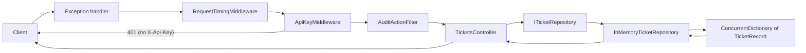

# Helpdesk API

Week 45 - 2026

A practice project focused on middleware, DI, options, and layers.

---

## Overview
- [About](#about)
- [Project Structure](#project-structure)
- [Helpdesk API](#helpdesk-api-1)
  - [Endpoints](#endpoints)
  - [Data Flow](#data-flow)
- [Sources](#sources)

---

## About

A small help desk API for support tickets, built in stages. Each stage adds one concept to the same project: 
middleware, filters, dependency injection, options and secrets, and layered structure.

Data lives in memory only and resets when app restarts.

---

## Project Structure

```text
HelpDesk.Api/
├── Controllers/
│   ├── ErrorController.cs                      Target of UseExceptionHandler("/error")
│   └── TicketsController.cs                    CRUD endpoints for tickets
├── Data/
│   └── InMemoryTicketRepository.cs             In-memory store, implements ITicketRepository
├── Filters/
│   ├── AuditActionFilter.cs                    An audit filter implementing IActionFilter interface
│   └── ValidateIdFilter.cs
├── Interfaces/
│   └── ITicketRepository.cs                    Contract for the ticket store
├── Middleware/
│   ├── ApiKeyMiddleware.cs                     A custom middleware. Rejects requests without X-Api-Key header
│   ├── RequestTimingMiddleware.cs              Custom middleware. Logs method, path, timing and code.
│   └── RequestTimingMiddlewareExtension.cs     Extension that calls on the middleware
├── Records/
│   └── TicketRecord.cs                         Ticket data model (record)
└── Program.cs                                  Service registration and middleware pipeline
```

---

## Helpdesk API

A ticket has an `id`, a `user`, a `dateOfIssue`, a `dateOfDeadline` (both UTC, ISO 8601), and a `description`.

**TicketRecord**

```csharp
namespace HelpDesk.Api.Records;

public record TicketRecord(
    int Id, string User, DateTime DateOfIssue, 
    DateTime DateOfDeadline, string Description
    );
```

---

### Endpoints

Base route: `api/tickets`

| Method | Path                | Purpose                                   | Success                 | Errors          |
|--------|---------------------|-------------------------------------------|-------------------------|-----------------|
| GET    | `/api/tickets`      | List all tickets                          | 200                     | N/A             |
| GET    | `/api/tickets/{id}` | Get one ticket                            | 200                     | 404, 400        |
| POST   | `/api/tickets`      | Create a ticket                           | 201 + `Location` header | 409 (id exists) |
| PUT    | `/api/tickets/{id}` | Replace a ticket / update                 | 200                     | 404             |
| DELETE | `/api/tickets/{id}` | Delete a ticket                           | 200                     | 404             |
| any    | `/error`            | Exception handler target, not for clients | 500 + problem json      | N/A             |

- The route id always wins over an id in the request body on `PUT`
- All the endpoints require an `X-Api-Key` header. Without one, the API returns `401`
- The middleware only checks that the header is present. Any value is accepted for now
- Unhandled exceptions return a short `application/problem+json` 500 response without the full stack trace

---

### Data Flow



- The controller depends on `ITicketRepository` interface, not on the concrete class
- `Program.cs` registers `InMemoryTicketRepository` as a singleton, so all requests share one store
- `ConcurrentDictionary` is used because that one instance is shared by concurrent requests, and for thread-safety
- Middleware runs in registration order. `ApiKeyMiddleware` short-circuits the request when the header is missing
- `AuditActionFilter` is applied to `TicketsController` with `[ServiceFilter]` and runs only for controller actions, 
  not for requests stopped by middleware.

---

## Sources

[ASP.NET Core Middleware](https://learn.microsoft.com/en-us/aspnet/core/fundamentals/middleware/?view=aspnetcore-10.0)  
[Write custom ASP.NET Core middleware](https://learn.microsoft.com/en-us/aspnet/core/fundamentals/middleware/write?view=aspnetcore-10.0)  
[Rider HTTP Request Syntax](https://www.jetbrains.com/help/rider/Exploring_HTTP_Syntax.html)    
[Swagger Config and Customize](github.com/domaindrivendev/Swashbuckle.AspNetCore/blob/master/docs/configure-and-customize-swaggerui.md)    
[Filters in ASP.NET Core](https://learn.microsoft.com/en-us/aspnet/core/mvc/controllers/filters?view=aspnetcore-10.0)  

---