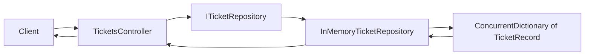

# Helpdesk API

Week 45 - 2026

A practice project focused on middleware, DI, options, and layers.

---

## Overview
- [About](#about)
- [Project Structure](#project-structure)
- [Helpdesk API](#helpdesk-api-1)
  - [Endpoints](#endpoints)
  - [Data Flow](#data-flow)
- [Sources](#sources)

---

## About

A small help desk API for support tickets, built in stages. Each stage adds one concept to the same project: 
middleware, filters, dependency injection, options and secrets, and layered structure.

Data lives in memory only and resets when app restarts.

---

## Project Structure

```text
HelpDesk.Api/
├── Controllers/
│   └── TicketsController.cs            CRUD endpoints for tickets
├── Data/
│   └── InMemoryTicketRepository.cs     In-memory store, implements ITicketRepository
├── Interfaces/
│   └── ITicketRepository.cs            Contract for the ticket store
├── Records/
│   └── TicketRecord.cs                 Ticket data model (record)
└── Program.cs                          Service registration and middleware pipeline
```

---

## Helpdesk API

A ticket has an `id`, a `user`, a `dateOfIssue`, a `dateOfDeadline` (both UTC, ISO 8601), and a `description`.

---

### Endpoints

Base route: `api/tickets`

| Method | Path                | Purpose                   | Success                 | Errors          |
|--------|---------------------|---------------------------|-------------------------|-----------------|
| GET    | `/api/tickets`      | List all tickets          | 200                     | N/A             |
| GET    | `/api/tickets/{id}` | Get one ticket            | 200                     | 404             |
| POST   | `/api/tickets`      | Create a ticket           | 201 + `Location` header | 409 (id exists) |
| PUT    | `/api/tickets/{id}` | Replace a ticket / update | 200                     | 404             |
| DELETE | `/api/tickets/{id}` | Delete a ticket           | 200                     | 404             |

- The route id always wins over an id in the request body on `PUT`

---

### Data Flow



- The controller depends on `ITicketRepository` interface, not on the concrete class
- `Program.cs` registers `InMemoryTicketRepository` as a singleton, so all requests share one store
- `ConcurrentDictionary` is used because that one instance is shared by concurrent requests, and for thread-safety

---

## Sources

[ASP.NET Core Middleware](https://learn.microsoft.com/en-us/aspnet/core/fundamentals/middleware/?view=aspnetcore-10.0)

---