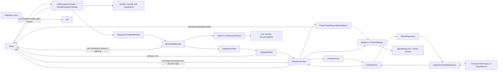
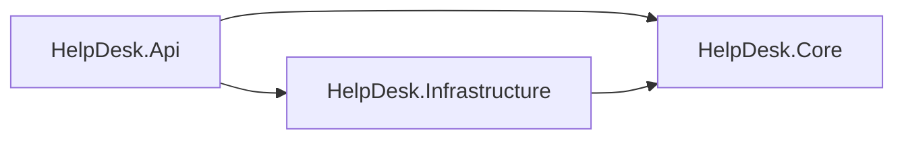

# Helpdesk API

Weeks 45 and 46 - 2026

A practice project focused on middleware, DI, options, layers, error handling, logging and validation.

---

## Overview
- [About](#about)
- [Project Structure](#project-structure)
- [Helpdesk API](#helpdesk-api-1)
  - [Endpoints](#endpoints)
  - [Data Flow](#data-flow)
  - [Layers](#layers)
- [Sources](#sources)

---

## About

A small help desk API for support tickets, built in stages. Each stage adds one concept to the same project:
middleware, filters, dependency injection, options and secrets, layered structure, global exception handling,
structured logging and validation.

Data lives in memory only and resets when app restarts.

---

## Project Structure

```text
HelpDesk.Api/                                       HTTP layer
├── Controllers/
│   ├── DiagnosticsController.cs                    Returns the three lifetime IDs (lifetime demo)
│   └── TicketsController.cs                        CRUD endpoints for tickets
├── DTOs/
│   └── CreateTicketRequestDto.cs                   Request body for POST, validated with Data Annotations
├── ExceptionHandlers/
│   └── GlobalExceptionHandler.cs                   Returns 500 Problem Details and logs the exception
├── Filters/
│   ├── AuditActionFilter.cs                        An audit filter implementing IActionFilter interface
│   └── ValidateIdFilter.cs                         Returns 400 when id is 0 or lower (GetById only)
├── Interfaces/
│   ├── IOperation.cs                               For the lifetime demo
│   ├── IOperationScoped.cs                         For the lifetime demo
│   ├── IOperationSingleton.cs                      For the lifetime demo
│   └── IOperationTransient.cs                      For the lifetime demo
├── Middleware/
│   ├── ApiKeyMiddleware.cs                         Rejects requests without the correct X-Api-Key header
│   ├── RequestTimingMiddleware.cs                  Logs method, path and timing
│   └── RequestTimingMiddlewareExtension.cs         Extension that calls on the middleware
├── Models/
│   └── Operation.cs                                One class registered three times for the lifetime demo
├── Settings/
│   ├── SecuritySettings.cs                         Holds the required ApiKey, bound to Security section
│   └── TicketSettings.cs                           Holds MaxTicketsReturned and MaxDescriptionLength
├── Validators/
│   └── CreateTicketRequestDtoValidator.cs          FluentValidation: description length from TicketSettings
├── appsettings.json                                Tickets settings and the Serilog configuration
└── Program.cs                                      Service registration, Serilog setup and middleware pipeline

HelpDesk.Core/                                      Business layer
├── Interfaces/
│   ├── ITicketRepository.cs                        Contract for the ticket store
│   └── ITicketService.cs                           A contract holding the methods for TicketService
├── Records/
│   └── TicketRecord.cs                             Ticket data model (record)
└── Services/
    └── TicketService.cs                            Implements ITicketService and calls the repository

HelpDesk.Infrastructure/                            Storage layer
└── Data/
    └── InMemoryTicketRepository.cs                 In-memory store, implements ITicketRepository

HelpDesk.Tests/                                     xUnit integration tests
├── Models/
│   └── ThrowingTicketRepository.cs                 Stub repository where every method throws
├── HelpDeskApiFactory.cs                           Starts the API in memory with a test API key
└── TicketsApiTests.cs                              Three tests: 200, 400 with errors, 500 without details
```

---

## Helpdesk API

A ticket has an `id`, a `user`, a `dateOfIssue`, a `dateOfDeadline` (both UTC, ISO 8601), and a `description`.

**TicketRecord**

```csharp
namespace HelpDesk.Core.Records;

public record TicketRecord(
    int Id, string User, DateTime DateOfIssue, 
    DateTime DateOfDeadline, string Description
    );
```

---

### Endpoints

Base route: `api/tickets`

| Method  | Path                | Purpose                                         | Success                 | Errors                                                          |
|---------|---------------------|-------------------------------------------------|-------------------------|-----------------------------------------------------------------|
| GET     | `/api/tickets`      | List all tickets (at most `MaxTicketsReturned`) | 200                     | N/A                                                             |
| GET     | `/api/tickets/{id}` | Get one ticket                                  | 200                     | 404, 400                                                        |
| POST    | `/api/tickets`      | Create a ticket                                 | 201 + `Location` header | 409 (id exists), 400 (validation error, with an `errors` field) |
| PUT     | `/api/tickets/{id}` | Replace a ticket / update                       | 200                     | 404                                                             |
| DELETE  | `/api/tickets/{id}` | Delete a ticket                                 | 200                     | 404                                                             |
| ~~any~~ | ~~`/error`~~        | ~~Exception handler target, not for clients~~   | ~~500 + problem json~~  | ~~N/A~~                                                         |
| GET     | `/api/Diagnostics`  | is a lifetime demo endpoint                     | N/A                     | N/A                                                             |

- The route id always wins over an id in the request body on `PUT`
- All the endpoints require an `X-Api-Key` header. Without one, the API returns `401`
- ~~The middleware only checks that the header is present. Any value is accepted for now~~
- Unhandled exceptions return a short `application/problem+json` 500 response without the full stack trace
- The middleware now compares the key with `Security:ApiKey` from the configuration
- `ErrorController` and `/error` are replaced by `GlobalExceptionHandler` (week 46)
- The 500 response has a `traceId`. The same value is logged with the exception, so the log entry can be found
- Validation errors return `400` Problem Details with an `errors` field that names each invalid field
- Logs go to the console and to `Logs/log.txt` through Serilog. The log folder is not in Git

---

### Data Flow



- The controller depends on `ITicketService` interface, not on the concrete class.
- `Program.cs` registers `InMemoryTicketRepository` as a singleton, so all requests share one store.
- `ConcurrentDictionary` is used because that one instance is shared by concurrent requests, and for thread-safety.
- Middleware runs in registration order. `ApiKeyMiddleware` short-circuits the request when the header is missing or wrong.
- `AuditActionFilter` is applied to `TicketsController` with `[ServiceFilter]` and runs only for controller actions, 
  not for requests stopped by middleware.
- `ValidateIdFilter` is applied to `GetById` only and returns `400` when the id is 0 or lower, before the action runs.  
- `ITicketService` and `TicketService` are registered as scoped.
- The service depends on `ITicketRepository`.
- `TicketsController` reads `MaxTicketsReturned` through `IOptions<TicketSettings>`. `MaxDescriptionLength` is read
  by `CreateTicketRequestDtoValidator`.
- `TicketSettings` is bound to the `Tickets` section of `appsettings.json` and validated when the app starts.
- `UseExceptionHandler()` is first in the pipeline. `GlobalExceptionHandler` writes the Problem Details response and
  logs the exception with the trace ID.
- `POST /api/tickets` takes `CreateTicketRequestDto`, not `TicketRecord`. `[ApiController]` checks its Data
  Annotations before the action runs. The action then calls the FluentValidation validator and maps the DTO to a
  `TicketRecord`.
- `RequestTimingMiddleware` and `AuditActionFilter` log through `ILogger<T>` with message templates.

---

### Layers

| Project                   | Responsibility                                                                                                                                  | References           |
|---------------------------|-------------------------------------------------------------------------------------------------------------------------------------------------|----------------------|
| `HelpDesk.Core`           | The business: the ticket entity, the business logic and the interfaces it needs from the outside. Knows nothing about HTTP or storage.          | Nothing              |
| `HelpDesk.Infrastructure` | Technical details: where tickets are stored. Implements Core's interfaces.                                                                      | Core                 |
| `HelpDesk.Api`            | HTTP: controllers, middleware, filters, DTOs, validators, the exception handler, settings and `Program.cs`, where everything is wired together. | Core, Infrastructure |
| `HelpDesk.Tests`          | xUnit test project for the API.                                                                                                                 | Api                  |



- Core depends on nothing, so it can be changed and tested without HTTP or a database.
- `ITicketRepository` is defined in Core and implemented in Infrastructure. Core says what it needs, and Infrastructure provides it.
- Api references Infrastructure only to register `InMemoryTicketRepository` in `Program.cs`.

---

## Sources

[ASP.NET Core Middleware](https://learn.microsoft.com/en-us/aspnet/core/fundamentals/middleware/?view=aspnetcore-10.0)  
[Write custom ASP.NET Core middleware](https://learn.microsoft.com/en-us/aspnet/core/fundamentals/middleware/write?view=aspnetcore-10.0)  
[Rider HTTP Request Syntax](https://www.jetbrains.com/help/rider/Exploring_HTTP_Syntax.html)    
[Swagger Config and Customize](https://github.com/domaindrivendev/Swashbuckle.AspNetCore/blob/master/docs/configure-and-customize-swaggerui.md)    
[Filters in ASP.NET Core](https://learn.microsoft.com/en-us/aspnet/core/mvc/controllers/filters?view=aspnetcore-10.0)  
[Dependency Injection ASP.NET Core](https://learn.microsoft.com/en-us/aspnet/core/fundamentals/dependency-injection?view=aspnetcore-10.0)  
[Handle errors in ASP.NET Core](https://learn.microsoft.com/en-us/aspnet/core/fundamentals/error-handling?view=aspnetcore-10.0)  
[Handle errors in ASP.NET Core APIs](https://learn.microsoft.com/en-us/aspnet/core/fundamentals/error-handling-api?view=aspnetcore-10.0)  
[RFC 9457: Problem Details for HTTP APIs](https://rfc-editor.org/rfc/rfc9457)  
[Serilog.AspNetCore](https://github.com/serilog/serilog-aspnetcore)  
[Serilog.Settings.Configuration](https://github.com/serilog/serilog-settings-configuration)  
[Logging in .NET and ASP.NET Core](https://learn.microsoft.com/en-us/aspnet/core/fundamentals/logging/?view=aspnetcore-10.0)  
[Model validation in ASP.NET Core MVC](https://learn.microsoft.com/en-us/aspnet/core/mvc/models/validation?view=aspnetcore-10.0)  
[FluentValidation: ASP.NET Core](https://docs.fluentvalidation.net/en/latest/aspnet.html)  
[Integration tests in ASP.NET Core](https://learn.microsoft.com/en-us/aspnet/core/test/integration-tests?view=aspnetcore-10.0)


---