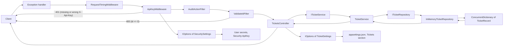
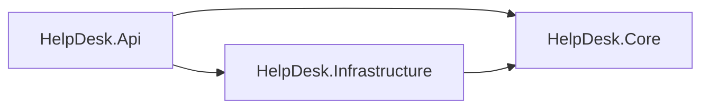

# Helpdesk API

Week 45 - 2026

A practice project focused on middleware, DI, options, and layers.

---

## Overview
- [About](#about)
- [Project Structure](#project-structure)
- [Helpdesk API](#helpdesk-api-1)
  - [Endpoints](#endpoints)
  - [Data Flow](#data-flow)
- [Sources](#sources)

---

## About

A small help desk API for support tickets, built in stages. Each stage adds one concept to the same project: 
middleware, filters, dependency injection, options and secrets, and layered structure.

Data lives in memory only and resets when app restarts.

---

## Project Structure

```text
HelpDesk.Api/
├── Controllers/
│   ├── DiagnosticsController.cs                Returns the three lifetime IDs (lifetime demo)
│   ├── ErrorController.cs                      Target of UseExceptionHandler("/error")
│   └── TicketsController.cs                    CRUD endpoints for tickets
├── Data/
│   └── InMemoryTicketRepository.cs             In-memory store, implements ITicketRepository
├── Filters/
│   ├── AuditActionFilter.cs                    An audit filter implementing IActionFilter interface
│   └── ValidateIdFilter.cs                     Returns 400 when id is 0 or lower (GetById only)
├── Interfaces/
│   ├── IOperation.cs                           For the lifetime demo
│   ├── IOperationScoped.cs                     For the lifetime demo
│   ├── IOperationSingleton.cs                  For the lifetime demo
│   ├── IOperationTransient.cs                  For the lifetime demo
│   ├── ITicketRepository.cs                    Contract for the ticket store
│   └── ITicketService.cs                       A contract holding the methods for TicketService
├── Middleware/
│   ├── ApiKeyMiddleware.cs                     A custom middleware. Rejects requests without X-Api-Key header
│   ├── RequestTimingMiddleware.cs              Custom middleware. Logs method, path, timing and code.
│   └── RequestTimingMiddlewareExtension.cs     Extension that calls on the middleware
├── Models/
│   └── Operation.cs                            One class registered three times for the lifetime demo
├── Records/
│   └── TicketRecord.cs                         Ticket data model (record)
├── Services/
│   └── TicketService.cs                        Implements ITicketService and calls method via the repository
├── Settings/
│   ├── SecuritySettings.cs                     Holds the required ApiKey, bound to Security section
│   └── TicketSettings.cs                       Holds MaxTicketsReturned and MaxDescriptionLength, validated using Range
└── Program.cs                                  Service registration and middleware pipeline
```

---

## Helpdesk API

A ticket has an `id`, a `user`, a `dateOfIssue`, a `dateOfDeadline` (both UTC, ISO 8601), and a `description`.

**TicketRecord**

```csharp
namespace HelpDesk.Api.Records;

public record TicketRecord(
    int Id, string User, DateTime DateOfIssue, 
    DateTime DateOfDeadline, string Description
    );
```

---

### Endpoints

Base route: `api/tickets`

| Method | Path                | Purpose                                         | Success                 | Errors                                      |
|--------|---------------------|-------------------------------------------------|-------------------------|---------------------------------------------|
| GET    | `/api/tickets`      | List all tickets (at most `MaxTicketsReturned`) | 200                     | N/A                                         |
| GET    | `/api/tickets/{id}` | Get one ticket                                  | 200                     | 404, 400                                    |
| POST   | `/api/tickets`      | Create a ticket                                 | 201 + `Location` header | 409 (id exists), 400 (description too long) |
| PUT    | `/api/tickets/{id}` | Replace a ticket / update                       | 200                     | 404                                         |
| DELETE | `/api/tickets/{id}` | Delete a ticket                                 | 200                     | 404                                         |
| any    | `/error`            | Exception handler target, not for clients       | 500 + problem json      | N/A                                         |
| GET    | `/api/Diagnostics`  | is a lifetime demo endpoint                     | N/A                     | N/A                                         |

- The route id always wins over an id in the request body on `PUT`
- All the endpoints require an `X-Api-Key` header. Without one, the API returns `401`
- ~~The middleware only checks that the header is present. Any value is accepted for now~~
- Unhandled exceptions return a short `application/problem+json` 500 response without the full stack trace
- The middleware now compares the key with `Security:ApiKey` from the configuration

---

### Data Flow



- The controller depends on `ITicketService` interface, not on the concrete class.
- `Program.cs` registers `InMemoryTicketRepository` as a singleton, so all requests share one store.
- `ConcurrentDictionary` is used because that one instance is shared by concurrent requests, and for thread-safety.
- Middleware runs in registration order. `ApiKeyMiddleware` short-circuits the request when the header is missing or wrong.
- `AuditActionFilter` is applied to `TicketsController` with `[ServiceFilter]` and runs only for controller actions, 
  not for requests stopped by middleware.
- `ValidateIdFilter` is applied to `GetById` only and returns `400` when the id is 0 or lower, before the action runs.  
- `ITicketService` and `TicketService` are registered as scoped.
- The service depends on `ITicketRepository`.
- `TicketsController` reads `MaxTicketsReturned` and `MaxDescriptionLength` through `IOptions<TicketSettings>`.
- `TicketSettings` is bound to the `Tickets` section of `appsettings.json` and validated when the app starts.

---

### Layers

| Project | Responsibility | References |
|---|---|---|
| `HelpDesk.Core` | The business: the ticket entity, the business logic and the interfaces it needs from the outside. Knows nothing about HTTP or storage. | Nothing |
| `HelpDesk.Infrastructure` | Technical details: where tickets are stored. Implements Core's interfaces. | Core |
| `HelpDesk.Api` | HTTP: controllers, middleware, filters, settings and `Program.cs`, where everything is wired together. | Core, Infrastructure |



- Core depends on nothing, so it can be changed and tested without HTTP or a database.
- `ITicketRepository` is defined in Core and implemented in Infrastructure. Core says what it needs, and Infrastructure provides it.
- Api references Infrastructure only to register `InMemoryTicketRepository` in `Program.cs`.

---

## Sources

[ASP.NET Core Middleware](https://learn.microsoft.com/en-us/aspnet/core/fundamentals/middleware/?view=aspnetcore-10.0)  
[Write custom ASP.NET Core middleware](https://learn.microsoft.com/en-us/aspnet/core/fundamentals/middleware/write?view=aspnetcore-10.0)  
[Rider HTTP Request Syntax](https://www.jetbrains.com/help/rider/Exploring_HTTP_Syntax.html)    
[Swagger Config and Customize](https://github.com/domaindrivendev/Swashbuckle.AspNetCore/blob/master/docs/configure-and-customize-swaggerui.md)    
[Filters in ASP.NET Core](https://learn.microsoft.com/en-us/aspnet/core/mvc/controllers/filters?view=aspnetcore-10.0)  
[Dependency Injection ASP.NET Core](https://learn.microsoft.com/en-us/aspnet/core/fundamentals/dependency-injection?view=aspnetcore-10.0)  


---