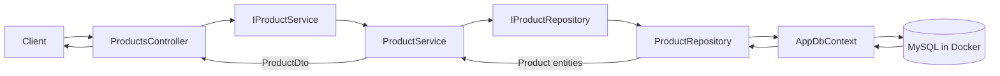
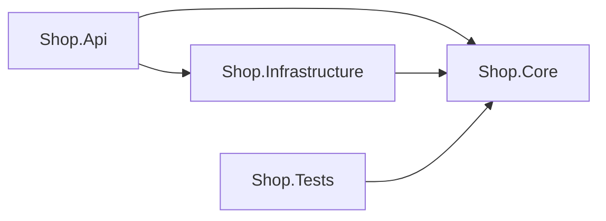

# Shop API

Week 47 - 2026

A practice project focused on Entity Framework Core and application architecture.

---

## Overview
- [About](#about)
- [Project Structure](#project-structure)
- [Shop API](#shop-api-1)
    - [Endpoints](#endpoints)
    - [Data Flow](#data-flow)
    - [Layers](#layers)
- [Migrations](#migrations)
- [Tests](#tests)
- [Sources](#sources)

---

## About

A small shop API for products, categories and order items, built in stages. The data flows from a MySQL table,
through an EF Core entity and DbContext, a repository and a service, and out of the API as a DTO.

The connection string is not in the repository. It is kept in user secrets.

---

## Project Structure

```text
Shop.Core/                              What the shop's data is, and what the app does with it
├── DTOs/
│   ├── CategoryDto.cs                  What the API returns for a category
│   ├── OrderItemDto.cs                 What the API returns for an order item
│   └── ProductDto.cs                   What the API returns for a product
├── Entities/
│   ├── Category.cs                     Category entity, with a list of products
│   ├── OrderItem.cs                    Order item entity
│   └── Product.cs                      Product entity, linked to one category
├── Interfaces/
│   ├── IProductRepository.cs           Contract for reading products from the database
│   └── IProductService.cs              Contract for the product service, returns DTOs
└── Services/
    └── ProductService.cs               Calls the repository and maps products to DTOs

Shop.Infrastructure/                    Database access
├── Data/
│   └── AppDbContext.cs                 EF Core context: three DbSets and the Category-Product relationship
├── Migrations/                         The two migrations and the model snapshot
└── Repositories/
    └── ProductRepository.cs            Reads products with EF Core, returns entities

Shop.Api/                               HTTP entry point and wiring
├── Controllers/
│   └── ProductsController.cs           GET all products and GET one product by id
├── Program.cs                          Registers AppDbContext, the repository and the service
└── Shop.Api.http                       Test requests for the two endpoints

Shop.Tests/                             xUnit unit tests for the service, with Moq
└── ProductServiceTests.cs              Three tests: count of DTOs, correct DTO, null when not found
```

---

## Shop API

A product has an `id`, a `name`, a `price`, a `categoryId` and a `stockQuantity`. Each product belongs to one
category, and a category can have many products.

The API returns `ProductDto`, which has `id`, `name`, `price` and `categoryId`. The `Category` navigation
property is left out, to avoid circular references in the JSON.

---

### Endpoints

Base route: `api/products`

| Method | Path | Purpose | Success | Errors |
|---|---|---|---|---|
| GET | `/api/products` | List all products | 200 | N/A |
| GET | `/api/products/{id}` | Get one product | 200 | 404 |

- Both endpoints return `ProductDto`, never the entity.
- The database runs in Docker, so the container must be running: `docker compose up -d`.

### Data Flow



- The repository returns entities, and the service maps them to DTOs. The controller only sees DTOs.
- Each layer depends on an interface, not a class. The DI container creates the objects and passes them in.
- `AppDbContext`, the repository and the service are all scoped: one instance each per request.

### Layers

| Project | Responsibility | References |
|---|---|---|
| `Shop.Core` | Entities, DTOs, the interfaces and the service with the mapping. Knows nothing about EF Core or HTTP. | Nothing |
| `Shop.Infrastructure` | `AppDbContext`, migrations and `ProductRepository`. Implements Core's repository interface. | Core |
| `Shop.Api` | `ProductsController` and `Program.cs`, where everything is registered. | Core, Infrastructure |
| `Shop.Tests` | Unit tests for the service, with a mocked repository. | Core |



---

## Migrations

The database is MySQL 8.4 in Docker. `compose.yaml` is in the solution folder, and the passwords are in `.env`,
which is not in the repository.

To set up the database from scratch:

```powershell
docker compose up -d
dotnet user-secrets set "ConnectionStrings:DefaultConnection" "server=localhost;port=3306;database=shopdb;user=<MYSQL_USER>;password=<MYSQL_PASSWORD>" --project Shop.Api
dotnet ef database update --project Shop.Infrastructure --startup-project Shop.Api
```

| Migration | What it does |
|---|---|
| `InitialCreate` | Creates `Categories`, `Products` and `OrderItems`, with the Category-Product foreign key |
| `AddStockQuantity` | Adds `StockQuantity` to `Products` |

---

## Tests

`Shop.Tests` holds unit tests for `ProductService`. The repository is replaced by a Moq mock, so the tests need
no database and no running API.

```bash
dotnet test Shop.Tests
```

| Test | Checks |
|---|---|
| `GetAllAsync_ReturnsThreeDtos_WhenRepositoryReturnsThreeProducts` | Three entities become three DTOs |
| `GetProductAsync_ReturnsCorrectDto_WhenProductExists` | The DTO gets the right values |
| `GetProductAsync_ReturnsNull_WhenRepositoryReturnsNull` | A missing product gives `null` |

---

## Sources

[Overview of Entity Framework Core](https://learn.microsoft.com/en-us/ef/core/)  
[Creating and Configuring a Model](https://learn.microsoft.com/en-us/ef/core/modeling/)  
[One-to-many relationships](https://learn.microsoft.com/en-us/ef/core/modeling/relationships/one-to-many)  
[DbContext Lifetime, Configuration, and Initialization](https://learn.microsoft.com/en-us/ef/core/dbcontext-configuration/)  
[Migrations Overview](https://learn.microsoft.com/en-us/ef/core/managing-schemas/migrations/)  
[EF Core tools reference (.NET CLI)](https://learn.microsoft.com/en-us/ef/core/cli/dotnet)  
[Efficient Querying](https://learn.microsoft.com/en-us/ef/core/performance/efficient-querying)  
[Dependency injection in ASP.NET Core](https://learn.microsoft.com/en-us/aspnet/core/fundamentals/dependency-injection?view=aspnetcore-10.0)  
[Safe storage of app secrets in development in ASP.NET Core](https://learn.microsoft.com/en-us/aspnet/core/security/app-secrets?view=aspnetcore-10.0)  
[Asynchronous programming scenarios](https://learn.microsoft.com/en-us/dotnet/csharp/asynchronous-programming/async-scenarios)  
[Pomelo.EntityFrameworkCore.MySql on GitHub](https://github.com/PomeloFoundation/Pomelo.EntityFrameworkCore.MySql)  
[mysql - Official Image on Docker Hub](https://hub.docker.com/_/mysql)  
[Moq Quickstart](https://github.com/moq/moq4/wiki/quickstart)