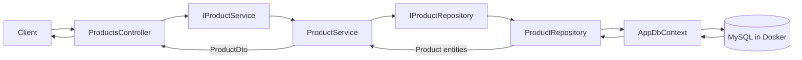
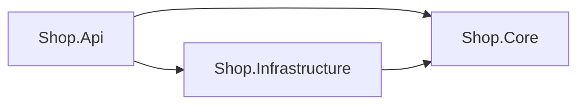

# Shop API

Week 47 - 2026

A practice project focused on Entity Framework Core and application architecture.

---

## Overview
- [About](#about)
- [Project Structure](#project-structure)
- [Shop API](#shop-api-1)
    - [Endpoints](#endpoints)
    - [Data Flow](#data-flow)
    - [Layers](#layers)
- [Migrations](#migrations)
- [Tests](#tests)
- [Sources](#sources)

---

## About

A small shop API for products, categories and order items, built in stages. The data flows from a MySQL table,
through an EF Core entity and DbContext, a repository and a service, and out of the API as a DTO.

The connection string is not in the repository. It is kept in user secrets.

---

## Project Structure

```text
Shop.Core/                              What the shop's data is
├── DTOs/
│   ├── CategoryDto.cs                  What the API returns for a category
│   ├── OrderItemDto.cs                 What the API returns for an order item
│   └── ProductDto.cs                   What the API returns for a product
└── Entities/
    ├── Category.cs                     Category entity, with a list of products
    ├── OrderItem.cs                    Order item entity
    └── Product.cs                      Product entity, linked to one category

Shop.Infrastructure/                    Database access
├── Data/
└── Migrations/                         The two migrations and the model snapshot
    └── AppDbContext.cs                 EF Core context: three DbSets and the Category-Product relationship

Shop.Api/                               HTTP entry point and wiring
└── Program.cs                          Registers AppDbContext with the MySQL provider
```

---

## Shop API

To be filled.

### Endpoints

Base route: `api/products`

| Method | Path | Purpose | Success | Errors |
|---|---|---|---|---|
| GET | `/api/products` | List all products | 200 | N/A |
| GET | `/api/products/{id}` | Get one product | 200 | 404 |

- Both endpoints return `ProductDto`, never the entity.
- The database runs in Docker, so the container must be running: `docker compose up -d`.

### Data Flow



- The repository returns entities, and the service maps them to DTOs. The controller only sees DTOs.
- Each layer depends on an interface, not a class. The DI container creates the objects and passes them in.
- `AppDbContext`, the repository and the service are all scoped: one instance each per request.

### Layers

| Project | Responsibility | References |
|---|---|---|
| `Shop.Core` | Entities, DTOs, the interfaces and the service with the mapping. Knows nothing about EF Core or HTTP. | Nothing |
| `Shop.Infrastructure` | `AppDbContext`, migrations and `ProductRepository`. Implements Core's repository interface. | Core |
| `Shop.Api` | `ProductsController` and `Program.cs`, where everything is registered. | Core, Infrastructure |



---

## Migrations

The database is MySQL 8.4 in Docker. `compose.yaml` is in the solution folder, and the passwords are in `.env`,
which is not in the repository.

To set up the database from scratch:

```powershell
docker compose up -d
dotnet user-secrets set "ConnectionStrings:DefaultConnection" "server=localhost;port=3306;database=shopdb;user=<MYSQL_USER>;password=<MYSQL_PASSWORD>" --project Shop.Api
dotnet ef database update --project Shop.Infrastructure --startup-project Shop.Api
```

| Migration | What it does |
|---|---|
| `InitialCreate` | Creates `Categories`, `Products` and `OrderItems`, with the Category-Product foreign key |
| `AddStockQuantity` | Adds `StockQuantity` to `Products` |

---

## Tests

To be filled.

---

## Sources

To be filled.