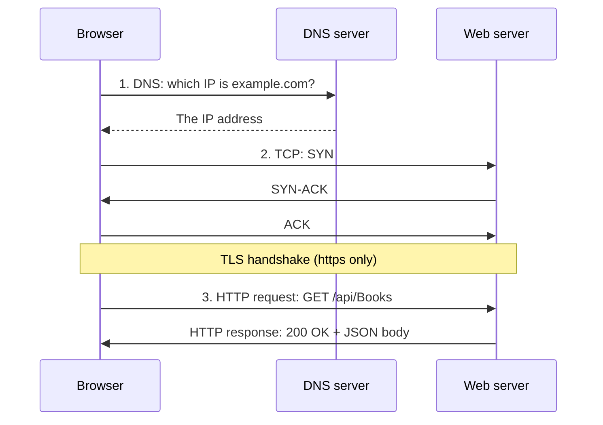

# Web API Basics

Goals for this project:
- [ x ] 1. I can explain what happens (DNS, TCP, HTTP) from the browser asking for a resource until the response arrives
- [ x ] 2. I can read an HTTP request and response and identify method, URL, headers, body and status code
- [ ] 3. I can explain at least three REST principles in my own words
- [ ] 4. I know what safe and idempotent mean and can give an example for GET, POST and DELETE
- [ ] 5. I can create a controller in ASP.NET Core with GET and POST endpoints
- [ ] 6. I use 201 Created with CreatedAtAction for POST and 404 NotFound for missing resources
- [ ] 7. I have tested my endpoints in Swagger UI or Postman
- [ ] 8. I can read an OpenAPI specification and understand what paths and components/schemas describe

---

## 1. What happens when a browser asks for a resource?

DNS lookup, get IP address, TCP: syn, Syn-ack, ack, HTTP request GET /api/books, HTTP response 200 OK + JSON body.



https://developer.mozilla.org/en-US/docs/Glossary/TCP_handshake  
https://developer.mozilla.org/en-US/docs/Web/HTTP/Guides/Messages  

---

## 2. HTTP request and response
This is a request that creates a book:
```text
POST /api/books HTTP/1.1
Host: localhost:5000
Content-Type: application/json
Content-Length: 30
{"id":2, "title":"Neuromancer"}
```

This is a response that returns a book:

```text
HTTP/1.1 201 Created
Content-Type: application/json
Location: /api/books/2
{"id":2, "title":"Neuromancer"}
```

Not every message has a body. GET usually does not. POST, PUT, nad PATCH requests do.

**Status codes**  

| Code | Meaning | Typical use |
|------|----------|-------------|
| 200 OK | Success, body has the result | GET |
| 201 Created | Resource created, Location header points to it| POST |
| 204 No Content | Success, nothing to return | PUT, DELETE |
| 400 Bad Request | The client sent invalid data | POST, PUT |
| 404 Not Found | The resource does not exist | GET, PUT, DELETE |

https://developer.mozilla.org/en-US/docs/Web/HTTP/Guides/Messages

---

## 3. REST principles

| Principle | In words | Example |
|-----------|-----------|---------|
| Resources with URIs | An API is built around "things". Each "thing" has its own address. | `/orders/1` (one order), `/orders` (collection) |
| Uniform Interface | Standard HTTP methods carry the action, so the URL needs no verbs. | `Post /orders`, not `create-order`  |
| Stateless Request | Each request carries everything the server needs. The server remembers nothing between requests. | Requests can arrive in any order, and any server instance can answer |
| Representations | The client gets a representation of the resource, usually JSON, not the database row. | `GET /orders/1` returns `{"orderId:"1, "quantity":1}` |
| HyperMedia (HATEOAS) | Responses include links to related sources and actions. | An order response with a link to its customer. |
| Platform independence and loose coupling | Any client can call the API, and client and server can change independently. | Standard HTTP plus JSON |

Use nouns, not verbs. Use plural nouns for collections (`/customers`, `customers/5`). Keep URIs simple. 
No deeper than collection/item/collection.

https://learn.microsoft.com/en-us/azure/architecture/best-practices/api-design

---

## 4. Safe and Idempotent
A method is safe if it doesn't change the server's state (read-only, like GET). A method is 
indempotent if making the same request several times has the same intended effect as making it once.
Every safe method is idempotent, but not every idempotend method is safe.

| Method | Safe? | Idempotent? | Example                                                                                 |
| ------ | ----- | ----------- | --------------------------------------------------------------------------------------- |
| GET    | Yes   | Yes         | `GET /api/books`. Repeating it changes nothing.                                         |
| POST   | No    | No          | `POST /api/books` creates a new book each time.                                         |
| DELETE | No    | Yes         | `DELETE /api/books/2` deletes the book. Repeating it does nothing after the first time. |

PUT is also idempotent, but not safe.

A client can retry an indempotend request after a timeout without causing harm.
Retrying a POST can create duplicates.  
The framework does not enforce this. The controller has to implement it.

https://developer.mozilla.org/en-US/docs/Glossary/Idempotent  
https://developer.mozilla.org/en-US/docs/Glossary/Safe/HTTP

---

## 5. Create a controller in ASP.NET Core
Two things must be in place:
- Program.cs registers controllers
- Controller class has the right attributes

```csharp
var builder = WebApplication.CreateBuilder(args);

builder.Services.AddControllers();
builder.Services.AddOpenApi();

var app = builder.Build();

if (app.Environment.IsDevelopment())
{
    app.MapOpenApi();
}
```
AddControllers registers the controller service.  
MapControllers connects the controller's routes to the app.

| Piece | What it does |
| ----- | ------------ |
| `: ControllerBase` | The base class for all controllers in ASP.NET Core. |
|`[ApiController] | Marks the class as an API controller and switches on API-specific behavior |
| `[Route("api/[controller]")]` | The base URL. [controller] becomes the class name without "Controller", so `BooksController` gives `/api/books`. |
| `[HttpGet]` | This method answers `GET /api/books`. |
| `[HttpGet("{id}")]` | This method answers `GET /api/books/1`. The id in the url arrives in the method parameter names `id`. |
| `[HttpPost]` | Answers `POST  /api/books`. The object comes from the request body. |
| `ActionResult<T>` | Return type. A returned object is serialized to JSON and sent as 200 OK. `ActionResult` can also carry other status codes. |

```csharp
public record Book(int Id, string Title);

[ApiController]
[Route("api/[controller]")]
public class BooksController : ControllerBase
{
    private static readonly List<Book> _books = [new(1, "Dune")];

    [HttpGet]
    public ActionResult<IEnumerable<Book>> GetAll()
    {
        return Ok(_books);
    }

    [HttpPost]
    public ActionResult<Book> Create(Book book)
    {
        _books.Add(book);
        return Ok(book);   // works, but section 6 shows the correct response
    }
}
```

https://learn.microsoft.com/en-us/aspnet/core/tutorials/first-web-api

---

## 6. Use 201 Created with CreatedAtAction and 404 NotFound
Two rules:

1. When a POST creates a new resource, return 201 Created and include a Location header with the URL 
of the new resource. Use `CreatedAtAction` to do this.
2. A request for something that doesn't exist should return 404 NotFound.

`CreatedAtAction` does the first one. `NotFound` does the second.

**Upgraded reference controller:**  

```csharp
[HttpGet("{id}")]
public ActionResult<Book> GetById(int id)
{
    var book = _books.FirstOrDefault(b => b.Id == id);

    if (book is null)
    {
        return NotFound();          // 404
    }

    return book;                    // 200 with the book as JSON
}

[HttpPost]
public ActionResult<Book> Create(Book book)
{
    _books.Add(book);

    return CreatedAtAction(
        nameof(GetById),            // which action finds the new item
        new { id = book.Id },       // the route values for that action
        book);                      // the response body
}
```

| Argument | Role |
| -------- | ---- |
| `nameof(GetById)` | The name of the action method that can retrieve the newly created resource |
| `new { id = book.Id }` | The route values needed to construct the URL for the new resource |
| `book` | The object to include in the response body |

https://learn.microsoft.com/en-us/aspnet/core/tutorials/first-web-api  
https://learn.microsoft.com/en-us/azure/architecture/best-practices/api-design  

---

## 7. Test endpoints in Swagger UI or Postman

**Add Swagger UI to a .NET 10 project**  

1. Install NuGet package `Swashbuckle.AspNetCore.SwaggerUi`.
2. Enable it next to `MapOpenApi()` inside the development check:

```csharp
if (app.Environment.IsDevelopment())
{
    app.MapOpenApi();

    app.UseSwaggerUI(options =>
    {
        options.SwaggerEndpoint("/openapi/v1.json", "v1");
    });
}
```

3. Run the app and open `https://localhost:5001/swagger` in a browser.

**Scalar**  

Microsoft also documents **Scalar** as an alternative UI.  

- install `Scalar.AspNetCore`
- call `app.MapScalarApiReference()
- open `/scalar` in a browser


**Postman** is also a viable option.


Run the tests:

| Request           | Expected Response                              |
| ----------------- | ---------------------------------------------- |
| GET /api/books    | 200 OK, JSON array of books                    |
| POST /api/books   | 201 Created, Location header, JSON of new book |
| GET /api/books/1  | 200 OK, JSON of book with id 1                 |
| GET /api/books/99 | 404 Not Found, no body                         |

https://learn.microsoft.com/en-us/aspnet/core/fundamentals/openapi/using-openapi-documents  
https://learn.microsoft.com/en-us/aspnet/core/tutorials/first-web-api  

---

## 8. Read an OpenAPI specification
An OpenApi document is a standard description of a REST API. 
It is usually in JSON or YAML format. It describes the paths, methods, parameters, request bodies, responses, and schemas of the API.

Two are very important:  

| Section            | What it describes                                                               |
| ------------------ | ------------------------------------------------------------------------------- |
| Paths              | The endpoints of the API, with their methods, parameters, and responses         |
| Components/Schemas | The data models used in requests and responses, with their properties and types |

The other sections are `openapi`, `info`, `servers`, `security`, `tags`, and `externalDocs`.
They are less important for this course.

**YAML Spec for BooksController**  

```yaml
openapi: 3.1.0
info:
  title: Library API
  version: 1.0.0
paths:
  /api/Books:
    get:
      summary: List all books
      responses:
        '200':
          description: A list of books
          content:
            application/json:
              schema:
                type: array
                items:
                  $ref: '#/components/schemas/Book'
    post:
      summary: Create a book
      requestBody:
        required: true
        content:
          application/json:
            schema:
              $ref: '#/components/schemas/Book'
      responses:
        '201':
          description: Created. The Location header points to the new book
          content:
            application/json:
              schema:
                $ref: '#/components/schemas/Book'
  /api/Books/{id}:
    get:
      summary: Get one book
      parameters:
        - name: id
          in: path
          required: true
          schema:
            type: integer
      responses:
        '200':
          description: The book
          content:
            application/json:
              schema:
                $ref: '#/components/schemas/Book'
        '404':
          description: No book with that id
components:
  schemas:
    Book:
      type: object
      properties:
        id:
          type: integer
        title:
          type: string
```

How to read it:  
- Each path plus method is one operation, and each operation matches one controller action.
  `/api/Books` with post is Create.
- Under responses, each key is a status code. The 404 under `/api/Books/{id}` is `NotFound()`.
- `$ref: '#/components/schemas/Book'` means "the shape defined under components, schemas, Book".
  It matches Book class, with id and title as properties.
- `{id}` in a path with `in: path` is the route parameter from `[HttpGet("{id}")]`.


---

## Sources

- [DNS (MDN)](https://developer.mozilla.org/en-US/docs/Glossary/DNS)
- [TCP Handshake (MDN)](https://developer.mozilla.org/en-US/docs/Glossary/TCP_handshake)
- [HTTP Messages (MDN)](https://developer.mozilla.org/en-US/docs/Web/HTTP/Guides/Messages)
- [Idempotent (MDN)](https://developer.mozilla.org/en-US/docs/Glossary/Idempotent)
- [Safe HTTP Methods (MDN)](https://developer.mozilla.org/en-US/docs/Glossary/Safe/HTTP)
- [API Design Best Practices (Microsoft)](https://learn.microsoft.com/en-us/azure/architecture/best-practices/api-design)
- [First Web API (Microsoft)](https://learn.microsoft.com/en-us/aspnet/core/tutorials/first-web-api)
- [Using OpenAPI Documents (Microsoft)](https://learn.microsoft.com/en-us/aspnet/core/fundamentals/openapi/using-openapi-documents)
- [Understanding OpenAPI Structure (Bump.sh)](https://docs.bump.sh/openapi/v3.2/understanding-structure/basic-structure/)
