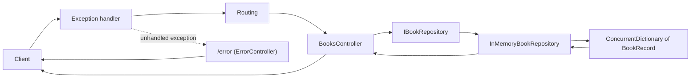

# Web API Basics

A practice project for Web API development using ASP.NET Core.

---

##  Overview
- [About](#about)
- [Endpoints](#endpoints)
- [Data Flow](#data-flow)
- [Project Structure](#project-structure)
- [Sources](#sources)

## About

This, and other projects in this solution, follow the learning journey from lectures
in the Advanced Backend Programming course @ Gokstad Akademiet. The project is a
simple Web API that demonstrates the basics of building RESTful APIs using ASP.NET Core.

It is a work in progress.

---

## Endpoints

Base route: `api/books`. Books are identified by their `id`.

| Method | Path              | Purpose                                    | Success                 | Errors          |
|--------|-------------------|--------------------------------------------|-------------------------|-----------------|
| GET    | `/api/books`      | List all books.                            | 200                     | N/A             |
| GET    | `/api/books/{id}` | Get one book.                              | 200                     | 404             |
| POST   | `/api/books`      | Create a book.                             | 201 + `Location` header | 409 (id exists) |
| PUT    | `/api/books/{id}` | Replace a book (update).                   | 200                     | 404             |
| DELETE | `/api/books/{id}` | Delete a book.                             | 200                     | 404             |
| any    | `/error`          | Exception handler target, not for clients. | 500 + problem json      | N/A             |

- The route id always wins over an id in the request body on `PUT`
- Unhandled exceptions return a short `application/problem+json` 500 response without a stack trace

---

## Data Flow



- The exception handler is the first middleware in the pipeline
- Data lives in memory only and resets when app restarts
- ~~`ConcurrentDictionary` is used because the store is static and shared between requests~~
- The controller depends on `IBookRepository`, and `Program.cs` registers `InMemoryBookRepository` as a singleton
- `ConcurrentDictionary` is still needed because that single instance is shared by all requests at the same time
  (also used for manual testing)

---

## Project Structure

```text
WebApiBasics/
├── Controllers/
│   ├── BooksController.cs           CRUD endpoints for books
│   └── ErrorController.cs           Target of UseExceptionHandler("/error")
├── Data/
│   └── InMemoryBookRepository.cs    In memory book repository, implements IBookRepository
├── Interfaces/
│   └── IBookRepository.cs           Contract for book repository
├── Records/
│   └── BookRecord.cs                Book data model (record)
└── Program.cs                       Service registration and middleware pipeline
```

---

## Sources

- [Handle errors in ASP.NET Core (Microsoft)](https://learn.microsoft.com/en-us/aspnet/core/fundamentals/error-handling?view=aspnetcore-10.0)
- [dotnet/aspnetcore #64920: OpenAPI integer types](https://github.com/dotnet/aspnetcore/issues/64920)
- [Swashbuckle.AspNetCore #3674: .NET 10 and Swagger UI](https://github.com/domaindrivendev/Swashbuckle.AspNetCore/issues/3674)